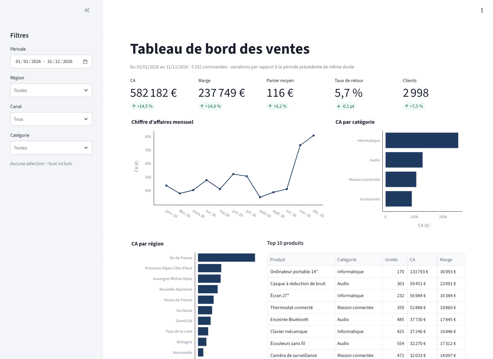

# Tableau de bord des ventes : vos données lisibles en un coup d’œil



**Problème** : les données de vente existent (exports du site, de la marketplace, de la caisse), mais personne n’a le temps de les croiser. Résultat : on pilote à l’intuition, et les questions simples (« quelle région progresse ? », « quel produit fait la marge ? ») restent sans réponse.

**Solution** : un tableau de bord web interactif, accessible depuis un simple lien, qui se met à jour avec vos données.

## Ce que montre le tableau de bord

- **5 indicateurs clés** : chiffre d’affaires, marge, panier moyen, taux de retour, nombre de clients, chacun comparé à la période précédente de même durée
- **Évolution mensuelle du CA**, pour repérer saisonnalité et tendances
- **CA par catégorie et par région**
- **Top 10 des produits** avec unités vendues, CA et marge
- **Filtres** par période, région, canal de vente et catégorie
- **Export CSV** des données filtrées, prêt à ouvrir dans Excel

Les données de cette démo sont fictives : 10 000 commandes d’un e-commerce d’électronique sur 2025-2026, générées de façon reproductible.

## Lancer la démo

```bash
pip install -r requirements.txt
streamlit run app.py
```

Les tests des calculs se lancent avec `pip install pytest` puis `pytest`.

## Structure

| Fichier | Rôle |
| --- | --- |
| `app.py` | Interface Streamlit (filtres, indicateurs, graphiques, export) |
| `metrics.py` | Calculs des indicateurs, séparés de l’interface et testés |
| `data.py` | Génération des données fictives |
| `tests/` | Tests automatiques des calculs |

## Adapter à votre activité

Il suffit de remplacer `data.py` par la lecture de vos propres sources : fichiers Excel ou CSV, export Shopify ou WooCommerce, base de données, Google Sheets. Les indicateurs sont choisis avec vous selon ce que vous voulez suivre. Le tableau de bord peut être hébergé gratuitement et protégé par mot de passe.

---

Réalisé par **Ayoub Ait Kaddi**, étudiant ingénieur à Télécom SudParis · Automatisation Python & data
